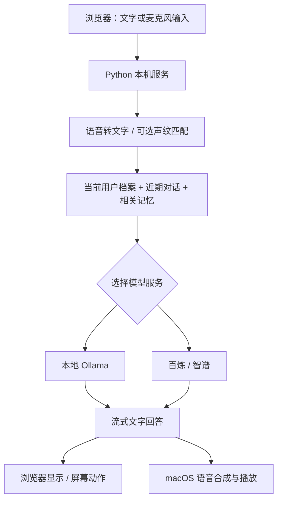

# 忆伴 · AI 陪伴助手

忆伴面向家庭、团队与组织的陪伴和记忆场景，以“爱凤”IP 作为后续实验方向。当前是一个可运行的浏览器原型，界面和默认唤醒词仍使用“小伴”。

**这是一个项目，提供本地 Ollama、阿里云百炼、智谱三种模型接入方式。前端由 Python 服务直接提供，不需要分别启动前端项目或执行 npm install。**

支持个人记忆与家庭／团队共同记忆。共同记忆使用独立空间账号，按成员角色、可见范围和修改权限管理；目前供本机体验。详见 [共同记忆使用说明](docs/SHARED_MEMORY.md)。

## 功能与支持范围

| 功能 | 当前实现 |
|---|---|
| 文字对话 | 本地 Qwen2.5 3B，或 OpenAI 兼容云端接口；支持流式显示 |
| 语音识别 | 本机 Sherpa-ONNX / SenseVoice INT8 |
| 唤醒与断句 | “你好小伴”唤醒；Silero VAD 检测说话与停顿 |
| 长期记忆 | SQLite 按档案保存与检索；支持关键词筛选、来源／时间、编辑删除、文字 JSON 导入导出、修改历史与冲突确认 |
| 共同记忆 | 家庭／团队空间、独立账号、成员角色、指定可见范围、修改权限、发布确认、历史、空间文字问答及语音查询／保存／修改与口头确认；历史资料读取、候选编辑、预览去重和确认导入；可选保留原文依据、待核实／有效／过时状态及历史 |
| 声纹识别 | 主动录入三段语音，匹配已登记用户；不确定时作为访客 |
| 首次称呼 | 识别后按档案里的自定义称呼问候，不根据声音猜测性别 |
| 打断 | 取消生成、停止播放；开启语音唤醒后可允许插话 |
| 对话诊断 | 每轮阶段、耗时、失败与打断状态；后台查看最近 20 轮并导出，详见 [使用说明](docs/VOICE_DIAGNOSTICS.md) |
| 看图 | 本地 Qwen2.5-VL 3B，单张照片问答；云端示例默认关闭 |
| 朗读 | Mac 系统音色选择、试听／停止、语速调整与保存，下一次朗读生效；Windows／Linux 朗读尚未接入 |
| 动作 | 网页里的点头、摇头等动画，尚未驱动实体电机 |
| 日期时间 | 每轮读取电脑时钟，使用北京时间；未接入天气、新闻、网页搜索 |

| 平台 | 使用方式与验证边界 |
|---|---|
| macOS | 主要开发与验证环境，可使用录音、朗读和双击启动脚本 |
| Windows | 提供 PowerShell 安装／启动步骤和本地配置；文字、浏览器采集、记忆等代码可复用，尚未进行 Windows 真机端到端验证；无朗读 |
| Linux／开发板 | 先进行文字模型接口联调；板端音频、TTS、NPU、Wi-Fi 音频和电机需要进一步适配 |

“婷婷”是 macOS 提供的中文合成语音，系统名称为 `Tingting`。当前通过 `/usr/bin/say` 把模型回答转成声音；最初选择它是为了让 Mac 原型无需额外语音服务即可运行。对话模型、语音合成和 ReSpeaker 拾音是独立环节，更换智谱／千问不会自动改变声音。后续可替换语音合成适配器，实现爱凤的专属音色；当前尚未实现声音克隆。若 Mac 未安装该语音，需要先在系统语音设置中下载。

共同记忆文字问答支持短期连续追问、同名活动选择和开始新话题；回答下区分模型声明的实际引用与其他候选，显示状态、日期与来源，已归档资料可按权限查看原文摘录。第一版按明确活动名称与日期衔接，每轮重新检查权限和检索；复杂指代仍需完善。使用方式与边界见 [检索与追问说明](docs/MEMORY_RETRIEVAL.md)，阶段进度与下一步见 [开发步骤](docs/NEXT_STEPS.md)。

共同记忆已支持**新安排替代旧安排**：从列表或文字请求生成新旧对照，确认归属、可见范围与状态转换后才生效。旧记录和已保留的原文继续可追溯；新记录沿用原作者与权限。操作步骤和限制见 [新旧安排替代说明](docs/MEMORY_REPLACEMENT.md)。

共同记忆文字回答支持反馈与回放。提交后可在「运行诊断 → 回答反馈」查看本人记录、当时问答及资料依据，更新处理进度并带回原问题复测。提交前需勾选本机保存同意，详见 [回答反馈说明](docs/ANSWER_FEEDBACK.md)。

## 页面入口

页面按任务分为五个标签：**陪伴对话、个人记忆、共同记忆、声音设置、运行诊断**。日常聊天默认进入陪伴对话；个人档案与声纹在个人记忆中管理。

共同记忆登录并选择空间后，再分为 **记忆问答、记忆库、资料导入、备份与恢复、空间与成员**：

- 记忆问答：提问、查看回答依据、选择目标、核对并确认 Agent 草稿；工具记录在问答下方。
- 记忆库：搜索／筛选、编辑、替代、历史内容恢复、纠正上次替代及移入回收站；发布表单默认收起，点击展开。
- 资料导入：读取历史材料、编辑候选、预览后确认导入。
- 备份与恢复：查看回收站与恢复记录；管理员下载完整空间备份，核对账号对应和权限，预览确认后恢复到新空间。
- 空间与成员：创建空间、管理成员及角色、设置口令与共同记忆语音模式。

切换页面标签保留未提交的输入和草稿，不会自动保存或确认；待确认的 Agent 草稿有顶部提示，可直接返回。切换空间、退出账号或刷新页面的原有清理规则仍适用。录音、播放和摄像头等进行中的操作不会因切换标签自动停止，顶部会提示其状态。标签支持左右方向键及 Home／End 导航。

## 回答声音设置（Mac）

点击顶部 **声音设置**：选择音色、调整语速（100–300，默认 195），点击 **试听当前选择**，满意后点击 **保存声音设置**。试听不保存，可随时停止；保存后从下一次朗读生效，不需要重启，重启后也会保留。

音色由本机系统语音库提供，中文排在前面；不代表每个音色都适合中文。此设置属于整台助手设备，不按个人／家庭账号区分。试听沿用当前系统输出和音量，不调用系统音量控制、不放大音频；不同音色的主观响度仍可能不同。试听暂停本页唤醒监听，结束后恢复；共同记忆语音模式和录音／回答期间禁止开始试听。

偏好保存在当前记忆数据库所在目录的 `speech-settings.json`（默认 `data/speech-settings.json`），优先于配置文件中的 `tts.voice`／`tts.rate`；不更改模型或记忆。此本机数据已被 Git 排除。未保存时仍使用原配置；旧音色失效或文件损坏会提示并暂用配置默认值。多页面同时修改时，较旧页面需点击“重新加载”再保存。安装新系统音色后，重启助手以刷新音色目录。

## 共同记忆语义检索

Mac 配置已启用本地 `qwen3-embedding:0.6b` 检索。先给助手使用的 Ollama 安装该模型，再重启助手；未安装时自动回退为有门槛的文字检索。它帮助理解不同问法，不替换回答模型。后台共同记忆问答显示找到几条资料、耗时和回退状态；语音共同记忆查询共用此能力。安装、停用、索引重建与虚构资料评测见 [使用与验收说明](docs/MEMORY_RETRIEVAL.md)。

## 工作流程



浏览器负责采集麦克风和摄像头。ReSpeaker 使用 USB 声卡方式时，先让操作系统识别，再在系统／浏览器中选择它作为输入；当前没有直接读取 USB 声卡或接收 ESP32 UDP 音频的独立进程。

## 1. 环境准备

- Python **3.12**：当前依赖组合在此版本上验证，优先使用此版本创建环境。
- Chrome 或支持麦克风、AudioWorklet 的现代浏览器，推荐先用 Chrome 验证。
- 本地模型模式需要安装 [Ollama](https://ollama.com/download)；百炼／智谱模式不需要 Ollama。
- 语音功能需要下载下文的本地语音模型；仅测试文字对话时可暂不下载。
- Git 用于克隆项目；Node.js 仅用于可选的前端逻辑测试。
- 首次安装依赖和下载模型需要网络；本地模型与语音资源齐备后可离线使用。

先克隆自己的仓库，或下载 ZIP 并解压；以下所有命令均在项目根目录执行。将示例 URL 替换为实际仓库地址。

```bash
git clone "https://github.com/YOUR_NAME/robot-assistant.git"
cd robot-assistant
```

### macOS

```bash
python3.12 -m venv .venv
./.venv/bin/python -m pip install --upgrade pip
./.venv/bin/python -m pip install -r requirements.txt
chmod +x start.command start-local.command start-cloud.command start-zhipu.command stop.command
```

如本机只有 `python3`，先用 `python3 --version` 确认是 3.12，再将上面的 `python3.12` 换成 `python3`。不需要激活虚拟环境，后续命令直接使用项目内的 Python。

### Windows（PowerShell）

安装 Python 3.12 和 Git，打开 PowerShell，进入项目目录后执行：

```powershell
py -3.12 -m venv .venv
.\.venv\Scripts\python.exe -m pip install --upgrade pip
.\.venv\Scripts\python.exe -m pip install -r requirements.txt
.\.venv\Scripts\python.exe -m pip install tzdata
```

`tzdata` 用于提供北京时间等 IANA 时区数据；Windows 通常没有系统时区数据库，参见 [Python 时区说明](https://docs.python.org/3/library/zoneinfo.html)。如果找不到 `py`，可使用已安装的 Python 3.12 对应的 `python` 命令。

Windows 不运行 `.command` 文件，也不使用目前依赖 Unix 进程管理的 `launcher.py`／`tools/cloud_setup.py`。按第 4 节直接运行 `server.py`，用 `Ctrl+C` 停止服务。这样也不需要修改 PowerShell 执行策略。

## 2. 准备本地语音模型

本地与云端对话都复用同一套语音资源。第一次完整语音体验需要这四项：

| 用途 | 资源 | 项目内位置 |
|---|---|---|
| 语音转文字 | SenseVoice INT8 压缩包 | `models/sherpa-onnx-sense-voice-zh-en-ja-ko-yue-int8-2024-07-17/` |
| 中文唤醒 | Wenetspeech Zipformer 3.3M 压缩包 | `models/sherpa-onnx-kws-zipformer-wenetspeech-3.3M-2024-01-01/` |
| 断句、声纹有效语音检测 | Silero VAD | `models/silero_vad.onnx` |
| 声纹特征提取 | 3D-Speaker ERes2Net | `models/speaker.onnx` |

模型来源：[SenseVoice 下载说明](https://k2-fsa.github.io/sherpa/onnx/sense-voice/pretrained.html)、[唤醒模型下载说明](https://k2-fsa.github.io/sherpa/onnx/kws/pretrained_models/index.html)、[VAD 模型索引](https://k2-fsa.github.io/sherpa/onnx/pretrained_models/)、[声纹模型发布页](https://github.com/k2-fsa/sherpa-onnx/releases/tag/speaker-recongition-models)。请使用这里指定的文件，代码中的路径和文件名与这些版本对应。

### macOS 下载命令

```bash
mkdir -p models
curl -fL --retry 3 -o models/sensevoice.tar.bz2 https://github.com/k2-fsa/sherpa-onnx/releases/download/asr-models/sherpa-onnx-sense-voice-zh-en-ja-ko-yue-int8-2024-07-17.tar.bz2
tar -xjf models/sensevoice.tar.bz2 -C models
curl -fL --retry 3 -o models/kws.tar.bz2 https://github.com/k2-fsa/sherpa-onnx/releases/download/kws-models/sherpa-onnx-kws-zipformer-wenetspeech-3.3M-2024-01-01.tar.bz2
tar -xjf models/kws.tar.bz2 -C models
curl -fL --retry 3 -o models/silero_vad.onnx https://github.com/k2-fsa/sherpa-onnx/releases/download/asr-models/silero_vad.onnx
curl -fL --retry 3 -o models/speaker.onnx https://github.com/k2-fsa/sherpa-onnx/releases/download/speaker-recongition-models/3dspeaker_speech_eres2net_base_sv_zh-cn_3dspeaker_16k.onnx
```

### Windows 下载命令

使用 Windows 自带的 `curl.exe` 和 `tar.exe`。如系统没有 tar，可用解压工具展开两个 `.tar.bz2` 文件到 `models`，保留压缩包内的目录名。

```powershell
New-Item -ItemType Directory -Force models | Out-Null
curl.exe -fL --retry 3 -o models/sensevoice.tar.bz2 https://github.com/k2-fsa/sherpa-onnx/releases/download/asr-models/sherpa-onnx-sense-voice-zh-en-ja-ko-yue-int8-2024-07-17.tar.bz2
tar.exe -xjf models/sensevoice.tar.bz2 -C models
curl.exe -fL --retry 3 -o models/kws.tar.bz2 https://github.com/k2-fsa/sherpa-onnx/releases/download/kws-models/sherpa-onnx-kws-zipformer-wenetspeech-3.3M-2024-01-01.tar.bz2
tar.exe -xjf models/kws.tar.bz2 -C models
curl.exe -fL --retry 3 -o models/silero_vad.onnx https://github.com/k2-fsa/sherpa-onnx/releases/download/asr-models/silero_vad.onnx
curl.exe -fL --retry 3 -o models/speaker.onnx https://github.com/k2-fsa/sherpa-onnx/releases/download/speaker-recongition-models/3dspeaker_speech_eres2net_base_sv_zh-cn_3dspeaker_16k.onnx
```

下载或解压报错时先停止，处理网络问题后再继续。需要确认的主要文件如下，不能多套一层同名目录：

```text
models/
├── silero_vad.onnx
├── speaker.onnx
├── sherpa-onnx-sense-voice-zh-en-ja-ko-yue-int8-2024-07-17/
│   ├── model.int8.onnx
│   └── tokens.txt
└── sherpa-onnx-kws-zipformer-wenetspeech-3.3M-2024-01-01/
    ├── encoder-epoch-12-avg-2-chunk-16-left-64.onnx
    ├── decoder-epoch-12-avg-2-chunk-16-left-64.onnx
    ├── joiner-epoch-12-avg-2-chunk-16-left-64.onnx
    └── tokens.txt
```

没有下载语音模型时，仍可先测试文字对话；录音、唤醒、声纹功能需等资源齐备后使用。

## 3. macOS 启动

### 3.1 本地模型：Ollama

新电脑先安装并打开 Ollama，保证其服务在 `http://127.0.0.1:11434` 运行。然后在终端下载模型：

```bash
ollama pull qwen2.5:3b
ollama pull qwen2.5vl:3b
ollama list
```

第二个是可选的看图模型，不使用摄像头问答可以暂不下载。下载时的 Ollama 服务与助手连接的服务必须是同一个。参见 [Ollama 命令说明](https://docs.ollama.com/cli)。

完成后双击 `start-local.command`，或运行：

```bash
./start-local.command
```

打开 **http://127.0.0.1:8765**。若网页没有自动打开，可手动访问。界面状态应显示本机对话已就绪及 `qwen2.5:3b`。

已有开发环境可能带有项目内的 `runtime/ollama/ollama`，启动器会在需要启动 Ollama 时优先使用它，并设置模型目录为 `models/ollama`；否则尝试 `/usr/local/bin/ollama`。系统 Ollama App 通常使用自己的模型目录。新电脑按上述方式先打开系统 Ollama，再拉取模型，可避免模型下载到一个目录、运行时却使用另一个目录的问题。

若提示找不到 Ollama，可先在单独终端运行 `ollama serve` 并保持该终端开启，再启动助手；如果端口已占用，说明已有实例，应检查该实例的 `ollama list`，不要重复启动。

### 3.2 智谱：GLM-4.7-Flash

双击 `start-zhipu.command`，或运行：

```bash
./start-zhipu.command
```

| 提示项 | 默认值 |
|---|---|
| Base URL | `https://open.bigmodel.cn/api/paas/v4` |
| 模型 ID | `glm-4.7-flash` |
| API Key | 从自己的智谱账号获取，在隐藏输入提示中填写 |

地址与模型可以直接回车使用默认值。程序先发送简短测试，成功后保存接口配置并重启助手服务。失败时不切换正在运行的本地服务。

该配置关闭思考模式、开启流式输出，看图关闭。API Key 不写入配置文件，只保留在本次启动的进程环境中；服务停止后重新启动需再次输入。`config/zhipu.local.json` 保存不含密钥的接口配置。免费资格、限流和价格以平台当前规则及账号控制台为准。

参考：[智谱模型与接口说明](https://docs.bigmodel.cn/cn/guide/models/free/glm-4.7-flash)。

### 3.3 阿里云百炼：Qwen Plus

双击 `start-cloud.command`，或运行：

```bash
./start-cloud.command
```

默认模型为 `qwen-plus`；默认地址 `https://dashscope.aliyuncs.com/compatible-mode/v1` 对应北京地域。优先填写自己控制台提供的 Base URL，并确保密钥、业务空间、地域与模型权限匹配；地址不要额外添加 `/chat/completions`。官方也提供业务空间专属地址，需将占位符替换成实际空间 ID。[接口说明](https://help.aliyun.com/zh/model-studio/qwen-api-via-openai-chat-completions)

启动器先检查模型列表和一条流式回答，成功后保存 `config/cloud.local.json` 并切换服务。密钥只在启动时隐藏输入，不写入文件。测试请求和后续对话按账号的额度及计费规则处理。

### 3.4 切换、重启与停止

| 操作 | 入口 |
|---|---|
| 打开已有服务；未启动时使用默认本地配置 | `start.command` |
| 明确切回本地模型 | `start-local.command` |
| 验证并切到智谱 | `start-zhipu.command` |
| 验证并切到百炼 | `start-cloud.command` |
| 停止本项目记录并启动的后台服务 | `stop.command` |

切换后刷新已有网页；记忆和声纹数据库不会因为切换而清空。关闭网页只释放页面使用的设备，不等于停止后台服务。`stop.command` 不会退出你单独打开的系统 Ollama App。

## 4. Windows 启动

Windows 使用同一份源码和网页，按以下步骤在 PowerShell 前台启动。**目前没有 Windows TTS 适配器，因此回答显示文字，不会朗读；语音识别与声纹仍需第 2 节的模型资源。**

### 4.1 本地模型

安装并打开 [Ollama Windows](https://docs.ollama.com/windows)，确认 `ollama` 命令可用，然后执行：

```powershell
ollama pull qwen2.5:3b
ollama pull qwen2.5vl:3b
ollama list
$env:ASSISTANT_CONFIG = "$PWD\config\windows.example.json"
.\.venv\Scripts\python.exe server.py
```

`windows.example.json` 关闭朗读和 Ollama 自动进程管理；Ollama 由其 Windows 应用负责运行。看图模型可选。启动后手动访问 **http://127.0.0.1:8765**，保持 PowerShell 窗口开启。

### 4.2 智谱模型

先用 `Ctrl+C` 停止当前前台助手。在项目根目录执行以下命令，输入密钥时不会显示明文：

```powershell
$env:ASSISTANT_CONFIG = "$PWD\config\cloud-zhipu.example.json"
$env:ZHIPU_API_KEY = [System.Net.NetworkCredential]::new('', (Read-Host '智谱 API Key' -AsSecureString)).Password
try {
    .\.venv\Scripts\python.exe server.py
} finally {
    Remove-Item Env:ZHIPU_API_KEY -ErrorAction SilentlyContinue
}
```

使用 `glm-4.7-flash`，默认关闭思考及看图。此方式直接启动服务，不经过 Mac 启动器的提前连通测试；打开网页后等待后台短对话检查，再发送一条简单问题验证。检查成功状态缓存 5 分钟，失败缓存 30 秒。云端配置里的 Mac 朗读适配器在 Windows 上检测为不可用，页面会禁用朗读。

### 4.3 百炼模型

同样先停止当前助手，然后运行：

```powershell
$env:ASSISTANT_CONFIG = "$PWD\config\cloud-bailian.example.json"
$env:ASSISTANT_MODEL_API_KEY = [System.Net.NetworkCredential]::new('', (Read-Host '百炼 API Key' -AsSecureString)).Password
try {
    .\.venv\Scripts\python.exe server.py
} finally {
    Remove-Item Env:ASSISTANT_MODEL_API_KEY -ErrorAction SilentlyContinue
}
```

默认采用北京地域地址和 `qwen-plus`。如需其他地址或模型，先复制示例为 `config/cloud.local.json`，编辑其中的 `llm.base_url` 和 `llm.model`，再将 `ASSISTANT_CONFIG` 指向该文件。不要把密钥写入 JSON。

### 4.4 停止与切换

在运行 `server.py` 的窗口按 `Ctrl+C` 停止助手，再执行另一种模式的命令。这里只停止助手，Ollama 在系统托盘中单独退出。修改配置后必须重启 Python 服务并刷新网页。

这些 Windows 命令是基于当前代码的启动路径整理，尚未在 Windows 真机验证。Windows 发声需要后续接入本地或云端 TTS，不能通过安装 Mac 的婷婷声音解决。

## 5. 首次体验与设备设置

1. **先文字聊天**：确认网页状态显示正确的模型，发送一句普通问题。不能仅凭网页打开就判定模型已接通。
2. **选好输入与输出**：USB ReSpeaker 需使用可传数据的线和 USB 音频固件。系统能识别后，选择 ReSpeaker 为输入；输出选择实际连接的扬声器，或 Mac／电脑自带扬声器。不要误选无实体扬声器的虚拟输出设备。
3. **测试手动录音**：允许浏览器麦克风权限，点击“点击说话”，说完后结束并发送。输入框里的“发送”只发送文字，不执行声纹识别。
4. **开启唤醒**：点击“开启语音唤醒”，说“你好小伴”，看到收音状态后提问；说完停顿约一秒会发送。
5. **建立用户与记忆**：在“用户与记忆”创建档案，明确说“记住：我喜欢简短回答”，或使用记忆管理界面保存内容。
6. **录入声纹**：由本人确认保存特征，录制三段不同内容，再保存并开启自动识别。建议每段连续说 6–10 秒，先在安静环境验证。
7. **测试打断**：Mac 上先用耳机测试；开启唤醒并勾选允许插话，回答或朗读时说新问题。也可点击“打断／停止”。Windows 可验证取消文字生成，但暂无朗读播放链路。
8. **测试看图**：本地视觉模型就绪后开启摄像头，点击拍照提问。只有本次明确拍摄的单张照片参与回答。

麦克风与摄像头不会在页面加载时自动申请权限。多个网页同时监听容易冲突，首次验证只保留一个助手页面。

详细说明见 [记忆、声纹与打断](docs/PERSONAL_FEATURES.md)。

## 6. 上下文、记忆与数据流

- 最近 30 条文字消息保存在当前浏览器中；每次请求提供最近 16 条消息，不等同于 16 轮对话。
- 长期记忆按档案保存在 `data/assistant.sqlite3`，需要用户明确保存。每个档案最多 200 条，每条最多 1200 字；每轮选择最多 8 条、总计不超过 2200 字作为背景。
- 在「用户与记忆」可按关键词筛选、查看保存来源与时间、编辑或删除，并导出当前用户全部文字记忆为 JSON。导出不受筛选影响，不包含声纹或浏览器聊天历史；导入时先预览新增／重复项，再勾选并确认恢复；仅合并新增记忆，不覆盖已有记录、称呼或声纹。
- 旧数据库启动时自动补齐记忆元数据字段，原内容与声纹保留；旧记录无法确认的首次时间和来源显示未知。升级前建议备份 `data/assistant.sqlite3`。
- 编辑记忆先核对差异再确认保存；每条可查看最近 100 次修改历史。相反喜好等有限规则触发冲突时，可确认并存或替换选定的一条。聊天指令和文件导入也检查这些规则，尚未实现通用语义矛盾判断。删除记忆会同步删除其历史，历史不参与模型回答。
- 共同记忆支持可选的本机语义＋文字混合检索、无结果门槛、索引维护和诊断；Mac 配置已启用，需安装检索模型。个人记忆仍用文字相似度；尚无自动摘要。使用、评测及边界见 [共同记忆检索增强](docs/MEMORY_RETRIEVAL.md)。
- “新对话”清空当前浏览器会话，不清空长期记忆。声纹未确认时按访客处理；手动选择档案也可以使用该档案的记忆。
- 声纹特征保存在本机，不保存原始登记录音。声纹用于个性化，不作为登录认证。
- 本地模式下模型推理在本机；云端模式会发送问题文字、近期对话、称呼和本轮相关记忆到所选服务。原始录音与声纹向量不发送到对话模型。
- 服务仅监听 `127.0.0.1`；共同记忆已有本机账号和权限控制，尚未开放跨电脑／公网访问。云端模型不代表自动具备网页搜索能力。

### 家庭／团队共同记忆

展开页面下方「家庭与团队 · 后台管理」→ 注册并登录空间账号 → 创建家庭或团队空间 → 添加已注册成员及角色 → 填写内容并选择可见范围／修改权限 → 预览并确认发布。管理员始终可管理空间全部记忆；编辑成员依每条权限编辑；只读成员只能查看可见内容。个人记忆不会自动共享。

使用同一面板的「询问共同记忆」获取当前账号有权查看的资料回答。开启语音前选择本人已登记声纹的档案，登录并选好空间，再点击「开启共同记忆语音」。之后可说“记住，内容”或“把原记忆关键词改成新内容”，完整听完后说“我确认保存这条共同记忆”或“我确认修改这条共同记忆”。后台会自动收起，页面仍需保持打开。成员管理、退出和使用边界见 [共同记忆说明](docs/SHARED_MEMORY.md)。

文字问答已接入「自动选择记忆工具」（默认勾选）：可以查询记忆、读取可见资料及归档摘录、读取当前时间，也可以提出新增或修改预览。修改有多个候选时先选目标；核对归属、可见成员和修改前后内容，勾选确认框并点击保存后才写入。未指定范围时，新增仅作者和管理员可见、修改保留原范围；取消、过期或版本变化后不能继续保存。入口仅在后台文字问答，普通聊天和语音保持原流程。详见 [记忆工具：预览与确认](docs/CONFIRMED_MEMORY_TOOLS.md) 和 [只读工具说明](docs/READ_ONLY_AGENT.md)。

## 7. 配置与代码结构

根目录保留日常启动入口；按下面的目录查找功能即可：

```text
yiban-github/
├── README.md            项目介绍、安装和启动
├── start*.command       Mac 启动／模型切换
├── stop.command         Mac 停止
├── server.py            Web 服务入口与接口
├── launcher.py          Mac 进程管理
├── requirements.txt     Python 依赖
├── yiban/               后台业务代码
│   ├── memory/          个人／共同记忆、权限、来源、资料导入
│   ├── audio/           唤醒、声纹、声音设置与音频诊断
│   ├── backends/        模型接口和语音合成适配
│   └── *.py             配置、取消、动作与会话诊断
├── static/              网页界面与浏览器交互
├── config/              配置示例与唤醒词
├── docs/                功能说明和硬件对接文档
├── tests/               测试与统一测试入口
└── tools/               云端配置、环境诊断、模型下载等工具
```

本机的 `data/`、`models/`、`runtime/`、`.runtime/` 和 `.venv/` 继续保留原位置，不纳入源码上传。文档入口见 [docs/README.md](docs/README.md)，测试入口见 [tests/README.md](tests/README.md)。 算法协作及自行实施方案见 [记忆检索任务书](docs/ALGORITHM_HANDOFF.md)（待实施）。

辅助工具请在项目根目录通过模块命令运行：`python -m tools.diagnose`（环境检查）、`python -m tools.cloud_setup`（百炼配置）、`python -m tools.cloud_setup --provider zhipu`（智谱配置）。Mac 双击启动脚本已同步更新，仍按原来的方式使用。

配置由 `yiban/settings.py` 默认值与 `ASSISTANT_CONFIG` 指定的 JSON 合并。文件只需填写要覆盖的字段；`ASSISTANT_PORT` 可以覆盖端口，默认 `8765`。

| 位置 | 职责 |
|---|---|
| `yiban/memory/shared_voice.py` / `static/shared-voice.js` | 共同记忆语音状态机、录音凭证、播报后口头确认与语音模式 |
| `yiban/memory/shared_memory.py` / `static/shared.js` | 空间账号、家庭／团队归属、成员权限、发布确认、历史和空间问答 |
| `server.py` | HTTP 接口、模型调用、当前时间和用户上下文组织 |
| `yiban/settings.py`、`config/` | 默认设置、Mac／Windows／云端／开发板配置 |
| `yiban/backends/models.py` | Ollama、OpenAI 兼容接口、流式解析、连接取消和代理 |
| `yiban/backends/speech.py` | SenseVoice ASR、macOS TTS 与禁用语音适配器 |
| `static/` | 网页界面、浏览器录音／摄像头、用户与记忆管理 |
| `yiban/audio/voice.py`、`config/keywords.txt` | 唤醒、VAD 断句、插话监听和关键词 |
| `yiban/memory/memory_store.py`、`yiban/memory/memory_review.py`、`yiban/audio/speakers.py` | SQLite 记忆、修改历史与冲突确认、声纹特征提取与匹配 |
| `yiban/turns.py`、`yiban/actions.py` | 每轮取消与固定屏幕动作 |
| `yiban/audio/diagnostics.py`、`tools/diagnose.py` | 声纹诊断记录、环境和模型检查 |
| `launcher.py`、`tools/cloud_setup.py` | Mac 服务管理与交互式云端启动 |
| `tests/` | 后端、前端逻辑与合成音频／图像验证 |
| `tools/download_vision.py` | 下载 Qwen2.5-VL 到项目 Ollama 模型目录并校验文件的辅助工具 |

`tools/download_vision.py` 使用项目的 `models/ollama`，不会把模型安装到另一个正在运行的系统 Ollama 实例。通常优先使用 `ollama pull`。

## 8. Linux／开发板联调

先确认厂商的 RK3588／RK182x 模型服务能独立回答，再使用文字模式接入。复制配置并填入实际接口地址和模型 ID：

```bash
cp config/board-text.example.json config/board.local.json
# 编辑 config/board.local.json 中的 llm.base_url 和 llm.model
export ASSISTANT_CONFIG="$PWD/config/board.local.json"
python3 -m tools.diagnose
python3 server.py
```

此配置关闭 ASR、唤醒和 TTS，文字模式不依赖 numpy／sherpa-onnx；使用 Python 3.12，并确保系统具有 Asia/Shanghai 时区数据。认证接口需通过配置里 `api_key_env` 指定的环境变量提供密钥。示例的 `8080` 是占位端口，应按厂商服务修改。

应用运行在板上时，可从电脑建立 SSH 转发后访问本机网页：

```bash
ssh -L 8765:127.0.0.1:8765 用户名@板卡IP
```

确保电脑本地的 8765 端口未被其他助手实例占用。浏览器使用的是打开网页的电脑上的麦克风／摄像头，不能据此认为已经接通板上的设备。

Linux TTS、板端音频采集、回声消除、ESP32 Wi-Fi 双向音频和实体动作仍需联调，详见 [开发板接入与分工](docs/HARDWARE_HANDOFF.md)。

## 9. 排查与验证

文字 Agent 已增加独立虚构资料评测与报告工具，并完善无答案引用、旧版依据、同名日期澄清和逐来源比较。使用及16题回归边界见 [文字评测说明](docs/AGENT_TEXT_EVALUATION.md)。

共同记忆的文字工具现可查看持久操作记录：登录空间 → 问答区 →「我的工具记录（当前空间）」。支持阶段耗时、预览/确认关联、异常筛选和JSON导出；只展示本人记录。实际用量缺失时显示未知。详见 [工具诊断说明](docs/AGENT_DIAGNOSTICS.md)。

| 现象 | 优先检查 |
|---|---|
| `.venv` 中找不到 Python | 是否在当前系统重新创建环境；Mac 与 Windows 的虚拟环境不能直接互拷 |
| Python 依赖安装失败 | Python 是否为 3.12、下载网络是否正常、当前架构是否有对应安装包 |
| 模型一直未就绪 | Ollama 是否运行、`ollama list` 是否有目标模型；云端检查地址、模型 ID、Key 权限与额度 |
| 切换后仍是旧模型 | 是否重启了实际服务并刷新网页；Mac 的 `start.command` 不负责切换已有服务 |
| 加密连接失败／SSL EOF | 检查系统代理、节点和网络；不要关闭证书验证，不能仅凭此错误判定 Key 无效 |
| 日期接口报 ZoneInfoNotFoundError | Windows 安装 `tzdata`，Linux 检查系统时区数据 |
| 没有声音输出 | Windows／Linux 暂未接 TTS；Mac 检查自动朗读、浏览器播放限制、系统输出与婷婷声音 |
| Windows 麦克风无权限 | 检查系统麦克风隐私设置、桌面应用权限和浏览器站点权限 |
| 声纹不匹配 | 查看页面“声音识别诊断”；检查模型、有效语音长度、输入设备和录入环境 |
| 唤醒无反应 | 检查 KWS 与 VAD 文件、麦克风权限，以及是否已开启监听 |
| 插话误触发 | 先戴耳机验证，检查扬声器回声；浏览器回声消除不等同于已完成硬件 AEC 联调 |

页面诊断展示最近 10 步。声纹日志在 `.runtime/speaker-diagnostics.jsonl`，记录时长、音频电平、相似度和拒识原因；不记录录音、聊天正文或声纹向量。Mac 后台服务日志在 `.runtime/assistant.log`；Windows 前台错误直接显示在 PowerShell。

查看正在运行的服务状态：

```bash
# macOS / Linux
curl http://127.0.0.1:8765/api/status
```

```powershell
# Windows
Invoke-RestMethod http://127.0.0.1:8765/api/status
```

状态中的 `model` 表示所配置模型，`chat` 表示对应检查是否通过；仍应实际发送问题确认完整回答。智谱的检查会触发短测试请求，并非只查询模型列表。

macOS 开发验证命令（需要 Node.js，具体分组见 [测试说明](tests/README.md)）：

```bash
./.venv/bin/python tests/run_all.py
```

Windows 可使用同样的测试入口检查兼容性，将 Python 路径替换为：

```powershell
.\.venv\Scripts\python.exe tests/run_all.py
```

测试使用模拟模型服务和临时数据库；部分音频测试依赖本地模型／合成素材。测试通过不代表 Windows 真机、云端账号、真人声纹或 ReSpeaker 声学效果已验收。

Mac 上还可在本地模型和语音资源齐备、助手已启动时验证完整管线：

```bash
./.venv/bin/python tests/make_audio_fixtures.py
./.venv/bin/python tests/check_pipeline.py
./.venv/bin/python tests/check_pipeline.py --vision
```

这些管线测试会实际调用当前模型与语音服务；合成音频生成依赖 macOS 声音。首次测试建议选择本地模式，并关闭其他页面的监听。
# yiban

共同记忆可由管理员下载完整JSON备份，核对账号对应、成员权限及资料后恢复到新空间，保留正文、原文、状态、历史和替代关系。详见 [备份与恢复](docs/SHARED_BACKUP.md)。

共同记忆误操作可从回收站恢复、恢复历史内容或纠正最近一次替代；先展示前后内容及权限，双重确认才生效。恢复内容转为待核实，保留历史、原文和原因。见 [误操作恢复说明](docs/SHARED_RECOVERY.md)。

个人记忆已接入同一本机向量模型：个人记忆页选择档案后可查询，查看实际引用与其他候选，无依据时明确提示。普通聊天展示相关候选，不等同于已引用。详见 [个人语义检索](docs/PERSONAL_RETRIEVAL.md)。[产品架构与后续分工](docs/PRODUCT_ARCHITECTURE.html) 可离线打开，切换成员／技术视角。
