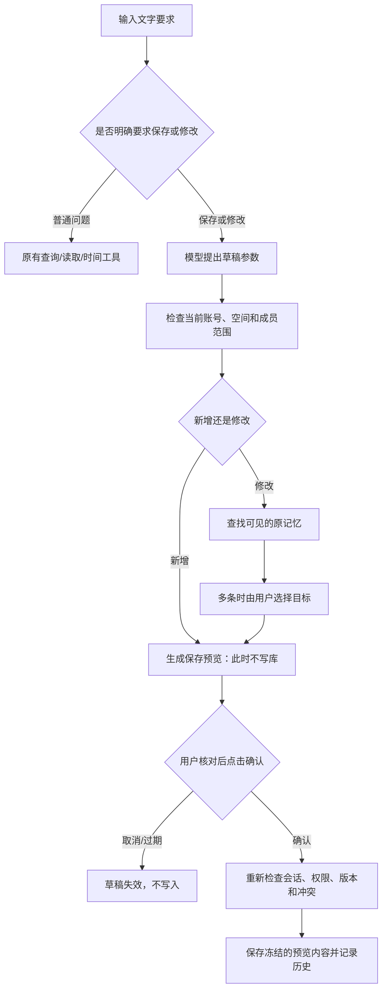

# 记忆工具：先预览，再确认保存

本阶段接入后台共同记忆的文字问答。语音继续使用原流程，尚未进行本轮真人语音验收。

## 使用步骤

1. 刷新页面，展开「家庭与团队 · 后台管理」，登录并选好家庭或团队空间。
2. 在「根据这个空间的记忆提问」保留勾选「自动选择记忆工具」。
3. 输入具体要求。例如：
   - `请记住：2026年12月6日举行暖冬手工课，下午两点在社区活动室集合，陈老师负责材料。让全体成员可见。`
   - `请保存：手工课预算暂定300元，仅张三可见。`（张三必须是当前空间中的真实成员名称）
   - `把暖冬手工课的集合时间改为下午三点，其他内容保持不变。`
4. 修改时如果查到多条候选，先根据完整内容选中确切的记忆。程序不会替你猜选哪一条。
5. 查看「保存前核对 · 尚未写入」：空间归属、作者、操作账号、保存后可见成员、修改权限、原内容与新内容、日期、状态和可能冲突。
6. 内容正确后，勾选核对框，再点击「确认保存这条记忆」或「确认保存这次修改」。有冲突时另需勾选冲突确认。
7. 保存后记忆列表更新，修改前后的内容进入现有历史记录。内容或范围不正确时点击「取消草稿」，重新描述完整要求。

**输入“确认”“直接保存”“不用预览”不会代替确认按钮。** 工具本身没有执行最终确认的能力。

## 默认规则

| 情况 | 行为 |
|---|---|
| 新增未指定范围 | 默认仅作者和管理员可见；仅作者和管理员可修改 |
| 明确指定成员 | 对照当前空间成员名称生成预览；作者和管理员始终可见 |
| 明确全体成员可见 | 预览显示全体成员，包括以后加入的成员，以及当前成员名单 |
| 修改未指定范围 | 保留原作者、可见范围和修改权限 |
| 修改正文或事件日期 | 自动回到待核实，核实后可在管理表单中单独标为有效 |
| 新增记忆 | 默认待核实；“确认保存”表示同意存储，不表示事实已被核实 |
| 查到多条记忆 | 先选目标，再生成修改预览 |
| 未找到可用目标 | 说明需要原文关键词或活动名称，不凭空新建替代记录 |
| 取消、停止、新话题、切换空间或退出 | 清除当前草稿；返回过晚的草稿也会撤销 |
| 资料、成员权限发生变化 | 旧预览失效，需重新生成并核对 |
| 10分钟过期、重复确认 | 拒绝写入，不重复保存 |

当前先支持新增单条、修改单条正文与可见范围。修改权限策略沿用原记录；跨空间搬移、批量写入、删除工具、自动确认、模型自行将记忆标为有效均不在本阶段。

## 程序如何保证先确认

普通问题先通过保守的写入意图限制，避免小模型把查询误判成保存。模型根据不同动作使用不同的参数约束；程序还会核对常见明确范围表达（如“仅某成员可见”“全体成员可见”）及新增记录的完整日期。复杂自然语言仍可能被误解，预览必须由使用者核对，程序校验不等于语义正确性证明。

## 代码与接口

- `yiban/memory/memory_agent.py`：继承只读调度器，增加 `save_memory_preview`、`update_memory_preview`，生成预览或候选选择。普通查询复用已有只读流程。
- `POST /api/shared/agent/memory/ask`：携带当前空间登录会话、`space_id`、`query` 和 `turn_id`。返回 `memory_preview` 或 `memory_selection`；普通问题仍返回回答与依据。
- 选择目标：再次请求同一 ask 接口，携带服务器返回的 `selection_token` 和 `memory_choice`。编号必须属于当前待选结果；不接受模型指定任意数据库ID。
- `POST /api/shared/agent/memory/confirm`：仅在用户明确确认时由页面调用，传 `space_id`、预览 `token`、`confirmed:true` 和必要的 `acknowledge_conflicts:true`。正文、范围、日期等都从服务器冻结的预览取值，不使用确认请求中的替换值。
- `POST /api/shared/agent/memory/cancel`：撤销候选选择或预览。
- `static/shared-agent.js`：独立的选择、预览、确认和取消面板，调用现有 `shared.js` 的会话清理与权限控件。内容用文本节点展示，不执行模型生成的HTML。
- 复用 `SharedMemory.preview/confirm` 处理冲突、角色权限、版本、数据库事务、历史和索引失效。Agent 对外只给一个绑定具体登录会话的额外随机编号，不暴露内部保存编号。

草稿保留在内存中，最多128个、10分钟有效，服务重启后失效。每轮生成60秒触发取消，实际返回时间还取决于底层模型连接的取消响应。只读动作的次数限制继续沿用原实现。确认与取消使用互斥处理；确认后消费预览，重复请求被拒绝。

当前复用结构化JSON聊天协议，不是供应商原生 `tool_calls`。如配置云端模型，草稿整理会发送当前问题及当前空间成员名称；修改还会发送所选原记录正文和日期。登录口令、确认编号不会交给模型。云端真实API、原生工具协议及真人语音尚未在本阶段验收。

## 文字测试

测试代码：`tests/test_memory_agent.py` 与前端检查，使用临时库与可控模型。覆盖未确认不写入、冻结内容、指定成员、未知成员、只读/无编辑权限、取消、过期、会话和空间隔离、重复确认、冲突确认、版本变化、取消中的预览清理、多候选选择、普通查询隔离和实际HTTP入口。

实际本机 `qwen2.5:3b` 使用隔离测试库验证新增、指定成员预览取消、修改时间、普通活动查询和日期查询；浏览器检查新增核对、选择目标、修改前后展示和确认保存。开发过程中发现并修复查询误判、无关参数、成员和日期漏填问题。上述属于开发样本验收，不代表任意自然语言或真实业务准确率。

本机完整结果及截图：`.runtime/acceptance/20261110-write-agent/`，不上传Git。测试没有写入原有用户数据库，也没有播放声音或调整音量。

运行：`python tests/run_all.py`；单独运行：`python -m unittest discover -s tests -p test_memory_agent.py`。
