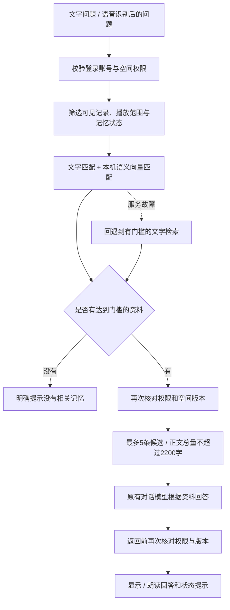

# 共同记忆检索增强：实现、使用与验收

本轮完成算法协作任务书的第一阶段工程实现：共同记忆的语义检索、无结果处理、索引维护和评测。先在 Mac 上运行；个人记忆、通用 Agent 工具调用、开发板部署不属于本轮范围。真实团队资料和真人语音效果仍需继续验收。

## 1. 用户能体验到什么

进入「家庭与团队 · 后台管理」，登录自己的空间账号、选择空间，在「根据这个空间的记忆提问」中输入问题。记忆写着“春季植树由李老师负责带队”，现在可以问“一起栽树那次，谁带着我们？”。问答下方显示检索方式、找到几条、检索耗时和降级提示；在「回答依据」查看实际引用；其他候选资料单独折叠展示。

共同记忆语音查询使用同一个检索入口。仍需先选择已登记声纹的档案，登录空间账号，再开启共同记忆语音。默认只朗读全体成员可见记录；原有私人播放选项和写入前口头确认继续生效。上方普通个人聊天没有改成共同记忆查询。

无相关记录时直接返回“当前可见范围内没有适用于本次问答的记忆”，不调用回答模型。多条相关但内容不一致的资料会一起提供给回答模型，由原有提示要求说明差异；本轮未实现自动冲突裁决或可靠的多轮澄清算法。

## 2. 处理流程



向量模型只计算“问题和记录有多相近”，不是回答模型。对话仍由原配置中的 Ollama 或云端模型处理；本机当前对话模型没有因增加检索而被替换。向量服务仅允许本机 HTTP 地址；若回答模型配置为云端，相关记忆仍会按原有机制发送给该回答服务。

## 3. 实现与代码接入

| 文件 | 职责 |
|---|---|
| `yiban/memory/retrieval.py` | 检索接口、Ollama Embedding 客户端、缓存、超时与取消、故障回退 |
| `yiban/memory/shared_memory.py` | 权限与状态筛选、检索调用、ID/版本核验、写入后的索引失效 |
| `server.py` | 注入检索模块，文字与共同记忆语音共用 `shared_answer`，无命中时不调用 LLM |
| `yiban/settings.py` | 校验检索配置；未指定时关闭新模块，便于兼容旧配置 |
| `yiban/conversation_diagnostics.py` | 检索策略、数量、耗时、回退原因白名单 |
| `static/shared.js`、`static/conversation-diagnostics.js` | 后台问答和每轮诊断展示 |
| `tools/evaluate_retrieval.py` | 固定虚构数据上的三种策略对比 |
| `tools/benchmark_retrieval.py` | 独立引擎的 1000 条资料性能测试 |
| `tools/retrieval_index.py` | 检查、归档并重建派生索引 |

接口为 `MemoryRetriever.retrieve(query, candidates, namespace=..., top_k=..., cancel=...)`，返回命中的 ID、版本、分数和诊断信息。`candidates` 必须由业务层完成授权与状态筛选；检索模块不能自行查询所有人的数据库。业务层重新从授权候选映射正文，不信任算法返回的正文或其他用户 ID。

混合策略按中文字符二元组匹配及向量余弦相似度筛选：余弦相似度至少 0.45，或文字重合至少 2 个二元组且查询覆盖率至少 0.18；排序分数为 `0.85 × 语义相似度 + 0.15 × 文字覆盖率`，相关性相同才参考状态。2026-11-10 修复增加相对分数门槛：普通具体问题仅保留得分至少达到最佳候选 85% 的记录，再截取 top_k；“分别／对比／所有／回顾”等宽泛问题保留较宽候选范围，避免漏掉对比对象。该规则不等于完整的主题识别，仍需真实难例评测。原始绝对阈值只在开发集选择，不能解释为“45% 确定回答正确”。金额、联系方式问题增加保守的字段存在检查；这不是适用于所有问题的答案充分性判断。

待核实记录保留原状态并明确提示；过时记录默认排除，勾选历史查询或使用已有的历史指令时才纳入。可见范围变化、退出、取消、删除、正文更新期间的结果，仍须通过现有版本与权限检查才能发送。

### 回答引用和状态提示（2026-11-10 修复）

回答模型接收只读资料编号 `reference`，返回 `{"answer":"回答正文","references":[1,2]}`。本地 Ollama 复用现有结构化输出接口；其他兼容服务依赖提示约束，服务端均检查返回格式和引用范围。

程序只接受本轮已授权候选范围内、不重复的整数编号。对格式正确的引用，仅为被引用的待核实／过时记录添加提示，并用该记录的短摘录说明具体是哪条；不再笼统说整个答案“尚不能确认”。空引用返回缺少依据提示，避免释放一个没有引用的事实断言。模型没有按格式返回时，不静默隐藏风险：普通文本保留对候选记录逐条限定的状态提示；截断或损坏的 JSON 返回重试提示，不直接朗读协议内容。

接口新增 `answer_source_ids` 与 `source_usage`（`model_reported`、`unavailable` 或未调用模型的 `not_needed`）。它们表示模型声明的引用及程序编号核验，不是对答案语义真实性的证明；网页按有效的模型引用编号分组：实际引用默认展开，其他候选单独折叠；编号缺失或异常时不推测引用关系，全部作为“引用关系未确认”的候选。

历史问题明确要求先回答旧版时间、地点等所问事实，再单独区分最新安排，避免只回答现行信息。对“现在几点集合”等活动日程问法，在模型输入中明确为最新活动安排；原问题与检索输入保留，显式钟表时间和历史问题不改写。该消歧是有限规则，复杂多意图问句仍需后续评测。取消、权限和空间版本检查仍在生成前后执行，不能通过引用编号扩大范围。个人记忆流程不受本次修改影响。

### 回答依据展示与原文查看（2026-11-10）

- **实际引用**：按 `source_usage=model_reported` 和 `answer_source_ids` 映射本轮授权资料，保留原始资料编号；网页再次检查编号是否属于候选且无重复。它表示模型声明引用，不是程序已经证明事实有出处或答案正确；小模型仍可能多引同主题资料。
- **其他候选资料**：被提供给回答模型但未列入引用的资料，默认折叠；空引用时全部为候选，不标成事实依据。引用缺失/异常时显示“引用关系未确认”，不擅自推断哪些被使用。无资料或活动澄清时不显示空的依据卡片。
- 每张卡显示记忆正文、有效/待核实/过时状态、状态说明、提供者、事件日期、记录更新时间、来源说明和已归档原文名称。没有填写事件日期时显示“未填写”，不把记录更新时间当成活动日期，也不从正文猜填。
- “查看原文摘录”按需调用原有原文接口。可见成员只能读随记忆开放的摘录；仍在空间内的作者和管理员可再点击查看完整原文文字。原文是整理时核对并保存的文字快照，不是原始PDF/图片文件；来源说明只是备注，不等于归档原文。
- 没有归档时显示“未保留原文依据”，不会从来源备注重建或自动抓取外部链接。完整原文和摘录不随问答自动加载，也不额外发送给回答模型。
- 查看时校验登录、空间成员、当前可见范围及卡片的记忆版本 `expected_version`。内容或状态更新后，旧卡片返回409并清除旧回答/依据，要求重新提问；权限撤销返回403并清空空间。新问题、退出、切换空间会关闭原文和清空卡片，迟到的原文响应不再显示。

实现：`static/shared-answer-sources.js` 渲染分组卡片，`shared-evidence.js` 复用原文面板；`question_context` 仅返回授权资料的展示元信息，更新日期/版本/原文名不加入模型资料正文。当前仍只展示最近一轮答案，不是长期对话审计记录。

### 文字连续追问与澄清（2026-11-10）

后台共同记忆问答现支持短期话题：先问“11月21日科学活动在哪里集合”，再问“需要带什么”“谁带队”；明确提及读书会可切换话题。页面显示当前话题，提供“开始新话题”；同名不同日期或缺少对象时先列活动选项，支持点击、输入“第二个”或日期，选定后继续原问题。

第一版使用资料中明确的活动名称和日期分组，属于有限规则，不是任意语义的多轮理解。建议同一活动的通知、物品清单都带相同名称和日期；同名跨日期不会自动合并，日期缺失且无法唯一归属时要求进一步说明。复杂代词、未命名事件、多事件混写、别名和隐含时间仍需后续改进；“分别／对比”等比较问题不自动把下一轮绑定到某一个活动。

服务端 `SharedDialogue` 只保存话题标识、标签与待澄清问题，不保存模型旧答案或记忆正文。每次追问重新授权、重新加载当前记录并检索。话题编号绑定具体登录会话、空间版本与历史/公开范围，10分钟失效；进程内最多128个，重启丢失。编号逐轮轮换，过期/重放/跨账号/跨空间/范围变化返回409，要求重新说明对象。退出、切换空间/个人档案、停止、开始新话题及改变历史选项时，网页清理上下文；服务端在生成前后仍校验权限和版本。

`POST /api/shared/ask` 的文字入口发送 `conversation_mode:true`、上一轮返回的 `conversation_id` 和可选 `choice_id`；不得提交自造历史作为事实。响应 `conversation` 含 `id`、`topic`、`needs_clarification`、`choices`。`POST /api/shared/ask/reset` 只清除当前登录会话拥有的编号。旧调用未开启 `conversation_mode` 时仍为单轮；本次未将新追问流程接到共同记忆语音入口，也未进行真人语音测试。

问答和澄清均不写入记忆。活动选择只是选择查询对象，绝不等同于保存、修改或删除确认。

## 4. 模型与运行配置

Mac 配置启用 `qwen3-embedding:0.6b`，模型文件约 639 MB（十进制）。安装模型后离线可用；首次需联网下载。模型上下文限制为 4096，超长输入不静默截断，而是报错后回退。默认最多等待 25 秒，单批 16 条，模型空闲保留 5 分钟；首次查询可能包含加载和建索引时间。

向**当前助手使用的同一个 Ollama 实例和模型目录**安装：通常执行 `ollama pull qwen3-embedding:0.6b`。若使用仓库随附的 Ollama，先启动本地助手；本仓库另提供 `python -m tools.download_embedding` 下载到 `models/ollama`，通过官方注册表获取并校验每个文件的 SHA-256。下载工具的分片缓存不上传 Git。

在实际使用的配置 JSON 顶层加入：

```json
"retrieval": {
  "enabled": true,
  "strategy": "hybrid",
  "base_url": "http://127.0.0.1:11434",
  "model": "qwen3-embedding:0.6b",
  "top_k": 5,
  "min_similarity": 0.45,
  "min_lexical": 0.18,
  "relative_score_floor": 0.85,
  "timeout": 25,
  "batch_size": 16
}
```

修改配置后重启服务。`enabled=true, strategy=lexical` 使用带相关性门槛的文字检索，适合不加载向量模型；`enabled=false` 完全退回旧排序，旧方案仍可能带入无关资料，不建议作为日常检索模式。其他云端、Windows 或开发板配置不会自动继承 `config/mac.json`，需单独配置。本轮未做 Windows 或开发板验收。

状态接口的 `retrieval.enabled` 仅代表模块开启，不保证向量模型已可用；某轮实际用了哪种策略，以该轮诊断的 `strategy` 和 `fallback` 为准。模型未安装、超时、返回异常或索引损坏时，回退到带门槛的文字检索，诊断显示“向量服务暂不可用，已回退文字检索”。

官方接口依据：[Ollama Embedding API](https://docs.ollama.com/api/embed)、[Qwen3-Embedding 模型页](https://ollama.com/library/qwen3-embedding:0.6b)、[Qwen 官方说明](https://github.com/QwenLM/Qwen3-Embedding)。

## 5. 记忆和索引存在哪里

原始资料、状态、成员权限、原文依据、历史和声纹继续由原 SQLite 数据库负责。本轮不迁移原始数据库，也不向真实数据库写入演示记录。

新文件是原数据库同级目录下的 `retrieval/vectors.sqlite3`，默认位于 `data/retrieval/vectors.sqlite3`。它只存派生向量、空间和记录 ID、版本、正文哈希、模型指纹，不保存问题或明文正文。向量仍属于敏感派生数据，整个 `data/` 继续被 Git 排除。

每次查询先重新筛选当前授权记录，然后按空间、记录 ID、版本、正文哈希、模型指纹复用缓存。新增/导入记录在下次查询时建立向量；正文变化或模型指纹变化会重新计算；修改与删除路径主动清理对应缓存。即使清理失败或并发建索引留下旧向量，旧条目也不能越过当前数据库候选和版本检查进入回答。

排查索引：

```bash
.venv/bin/python -m tools.retrieval_index --config config/mac.json
```

需要重新构建时，先停止助手，再执行下列命令，随后正常启动。命令只归档派生索引，下次查询按当前授权资料重建；保留的旧索引备份也包含敏感派生数据。

```bash
.venv/bin/python -m tools.retrieval_index --config config/mac.json --reset
```

## 6. 评测方法和结果

数据版本：`synthetic-v1`，全部由开发者编写，为 20 个虚构事件、80 条记录、200 道题。按事件分组，120 题用于开发，80 题固定验收；没有将同一事件的改述分到两边。数据哈希和逐题 ID/结果见 [可复查评测结果](evaluation/retrieval-v1.json)。

开发集上，语义阈值 0.60 的 Hit@5 为 41/60（68.3%），0.45 为 58/60（96.7%）；因此固定为 0.45。验收集不再用于调阈值。之后只因减少内存配置重复验收，结果保持一致。

| 验收集指标 | 原有排序 | 有门槛文字检索 | 混合语义检索 |
|---|---:|---:|---:|
| 有答案题 Hit@5 | 22/40，55% | 24/40，60% | 40/40，100% |
| 普通无答案误匹配 | 24/24 | 0/24 | 0/24 |
| 隔离类问题返回无关记录 | 8/16 | 0/16 | 0/16 |
| 返回越权记录 | 0 | 0 | 0 |

这里 Hit@5 表示正确资料是否出现在前五条中，**不是回答正确率，也不是每条返回资料都正确**。隔离类旧排序返回的是当前可见的无关记录，不能据此说旧版本泄漏了他人记录。权限安全还通过临时数据库的业务测试检查，不能只依赖评测脚本里的候选筛选。

该数据集较小、问法有模板性，无答案题主要是缺少预算、电话和明显无关问题。缺失字段规则对结果有较大帮助。尚未经过独立人工标注，也未覆盖复杂指代、多个同名活动、真实 ASR 错字和全部无答案类型。因此以上结果仅作为工程基线，不能据此宣称真实业务“100% 准确”。

本报告不披露测试设备型号、系统版本或物理内存容量；耗时仅代表本次测试，不作为跨设备性能保证。1000 条虚构记录、200 次热查询：空索引首次建立及查询 22.303 秒；热查询中位数 464.5 毫秒，P95 为 482 毫秒，200 次均完整命中缓存且没有回退。索引体积约 21.6 MiB。这里“空索引”不保证模型已卸载；计时只覆盖检索引擎，不包括语音识别、回答生成和播放。原有空间业务上限仍是 200 条，1000 条只是引擎压力测试，并未扩大产品容量。详见 [性能原始结果](evaluation/retrieval-performance-v1.json)。

Ollama 报告该检索模型分配约 1.155 GiB（不是进程 RSS 或整个应用的内存总量）。对话、看图、ASR 等模型会另占内存，不能把 639 MB 的下载大小当作运行内存。限制上下文前同一模型报告约 4.436 GiB，因此最终固定为 4096 上下文。

复现（在项目根目录）：

```bash
.venv/bin/python tests/run_all.py
.venv/bin/python -m tools.evaluate_retrieval --split dev --strategy all
.venv/bin/python -m tools.evaluate_retrieval --split test --strategy all
.venv/bin/python -m tools.benchmark_retrieval --records 1000 --queries 200
```

评测工具只读取 `tests/fixtures/retrieval` 中的虚构资料；结果和缓存写到被忽略的 `.runtime/`。性能工具单次空索引创建会增大该目录磁盘占用。测试服务与真实服务使用不同端口和数据库。

## 7. 验证范围与下一步

本轮最终运行 156 项后端测试全部通过、无跳过，前端逻辑检查通过。Mac 服务已启用检索模块；这些检查仍不能替代真实资料和真人语音验收。

- 已检查：文字与语义两种策略、无相关内容不调用 LLM、身份/可见范围/状态筛选、返回 ID 和版本核验、撤销权限、删除后失效、缓存版本和模型变更、索引损坏回退、网络超时、请求中和排队时打断、诊断不含正文和向量。
- 浏览器用虚构团队完成了语义改述问答、依据展示和缺少预算时的无结果提示；未播放声音或更改系统音量。语音查询共用同一后端；这次没有替代真人录音、声纹、扬声器打断的验收。
- 无自动写入新路径，保存、修改、删除仍走现有权限与确认流程。向量搜索不会自动共享个人记忆。
- 下一步先收集 20～30 个经授权脱敏的真实问题，由团队标注正确资料和应拒答问题，检查误召回、漏召回和最终回答引用；通过后再将检索能力接入个人记忆，最后扩展更自然的工具请求与澄清。

本阶段可以由我们继续维护；算法协作者的主要价值将转向真实数据评测、难例分析、检索排序与阈值校准，而不是必须先训练模型才能开始。
