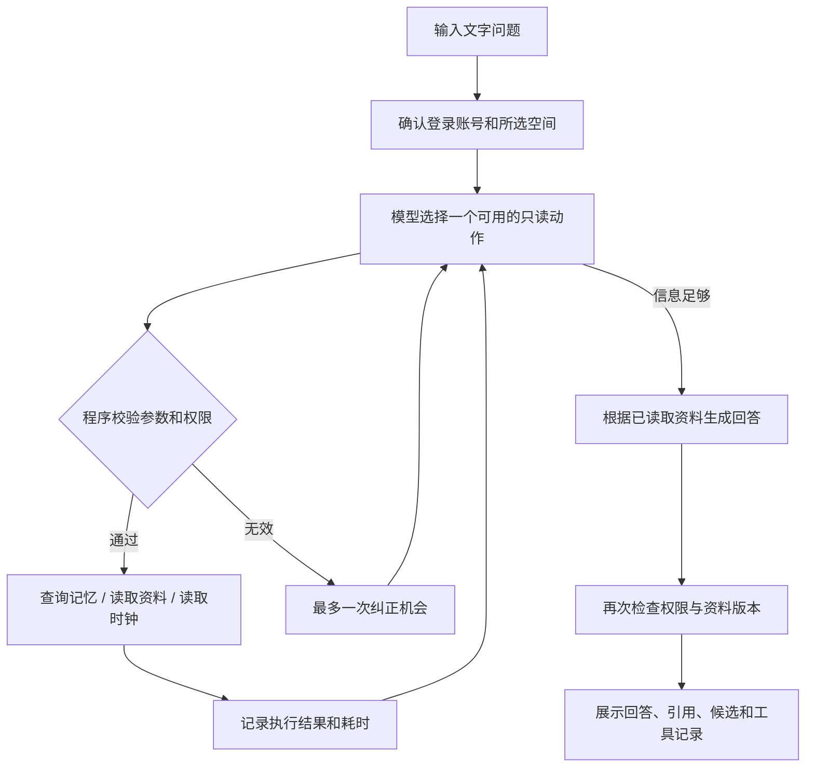

# 共同记忆只读 Agent：使用与验收

本文说明只读工具模块。当前后台开关已改为「自动选择记忆工具」，并另接入了需要人工确认的新增/修改预览，详见 [预览与确认说明](CONFIRMED_MEMORY_TOOLS.md)。普通聊天和语音入口保持原流程。

## 如何使用

1. 刷新网页，展开「家庭与团队 · 后台管理」。
2. 登录空间账号，选择家庭或团队。
3. 在「根据这个空间的记忆提问」中保留勾选「自动选择记忆工具」。
4. 输入问题，点击「询问共同记忆」。结果下方的「本轮工具记录」展示实际执行的步骤、状态、资料数量和工具执行耗时。
5. 查看回答依据：模型声明的实际引用和其他候选分别展示；有归档原文时可按现有权限查看摘录。

可试的问题：

- 今天几号？现在几点？
- 秋日亲子科学活动在哪里集合，谁带队？（替换为自己已有资料中的活动名）
- 那需要带什么？
- 冬季观鸟活动确定了吗？
- 团队活动预算多少？（资料没有时应说明查不到）

关闭自动工具即可回到原文字问答。停止、切换空间、退出账号或开始新话题会清理本轮结果和话题；已有话题仍按原有10分钟有效期处理。

## 三个工具分别做什么

| 工具 | 模型能提出的参数 | 程序执行的内容 |
|---|---|---|
| `search_memory` | 搜索问题 | 在当前登录账号、当前空间与查询范围内复用混合检索；返回编号、短摘要、状态和事件日期 |
| `read_material` | 本轮搜索结果的编号，单次最多5条 | 重新检查权限和版本，读取对应正文、状态、事件日期、来源备注和已归档的可见摘录 |
| `get_current_time` | 无 | 读取电脑时钟，返回 Asia/Shanghai 的日期、星期和时间；不需要联网 |

另有内部 `finish` 动作表示结束工具选择，不执行外部操作。电脑时钟准确性依赖系统本身。

读取资料指本轮搜索到的记忆及其归档摘录，不是任意读取电脑文件、URL、完整导入文件或个人档案。已授权的完整原文仍由用户在原文面板主动查看；工具不自动发送完整原文。若以后切换云端对话模型，问题、可见搜索摘要、选中正文和受限摘录会通过当前配置的模型服务处理。

## 执行流程与代码对接

- 新接口：`POST /api/shared/agent/ask`，使用现有 Bearer 空间登录会话。请求字段沿用原文字查询：`space_id`、`query`、`conversation_mode`、`conversation_id`、`choice_id`、`include_outdated`、`turn_id`。
- `yiban/memory/read_only_agent.py`：有限次数的模型选择循环、动态动作 schema、严格参数校验、取消/超时、工具轨迹与回答生成。
- `yiban/memory/shared_memory.py`：`question_guard`、`read_question_material`，复用 `question_context`、原有权限和来源证据读取。
- `server.py`：新接口分发；`static/shared.js` 和 `static/index.html`：开关与工具记录。原 `/api/shared/ask` 和语音接口保持兼容。
- 复用 `ModelClient.chat` 的结构化 JSON 协议，由模型选择动作、程序实际执行。Ollama 使用 JSON schema 约束；云端沿用现有聊天传输和严格解析，未改为供应商原生 `tool_calls`，不宣称已经验证所有云端模型。
- 每轮最多6次动作选择、4次工具执行；60秒触发取消，实际返回还受底层连接取消响应速度影响。查询和时钟各最多一次。已读编号不重复读取，不在本轮搜索中的编号拒绝；动态 schema 只暴露剩余动作。
- 工具耗时不包含模型选择和回答生成耗时，不是整轮耗时。记录在本次页面结果中，不是持久审计台账；Token成本、跨轮成功率统计待后续增加。

## 权限与失败处理

模型不能指定任意账号、其他空间、数据库ID、路径、URL、命令或写入动作。每一步及返回前重新验证当前账号、成员权限和空间版本；撤权或资料变更时拒绝过时回答。资料中即使包含指令，也不能增加工具权限。

未读取的候选不能被当作已读来源引用。回答引用继续做编号校验、待核实/过时提示；引用声明不等于事实语义证明，小模型仍可能遗漏或多引，需结合原文核对。遇到格式错误、反复请求、超时等情况返回停止说明，不把未完成的回答当作成功。

本阶段没有保存、修改、删除、发消息、联网搜索、文件系统访问等工具；涉及写入继续使用已有预览与人工确认流程。

## 验收记录（2026-11-10）

- 210项后端测试和前端检查通过：包含工具白名单与参数、同空间权限、不可见记录、原文摘录隔离、只读不写库、引用编号重排、动态动作限制、活动澄清、撤权/版本变化、取消/超时和真实HTTP路由。
- 本机 `qwen2.5:3b` 使用独立临时数据库，复测日期时间、活动地点/带队人、待核实提议、大巴安排、缺失预算5题；修正重复调用后5题均完成。该小样本是开发验收，不是整体准确率。
- 浏览器文字验收记录、实际模型回答和截图保存在本机 `.runtime/acceptance/20261110-read-agent/`，不上传Git。
- 语音、真人声纹、扬声器播放、云端真实API和开发板未在本轮验收。

运行回归：`python tests/run_all.py`；单独运行：`python -m unittest discover -s tests -p test_read_only_agent.py`。
